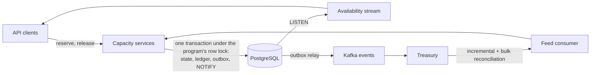
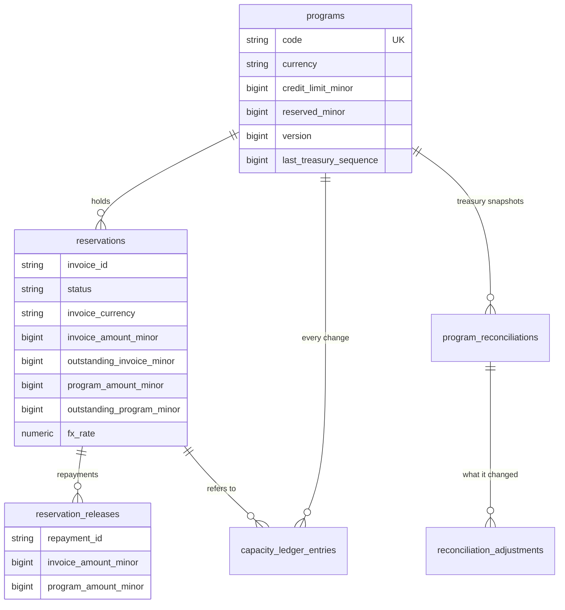
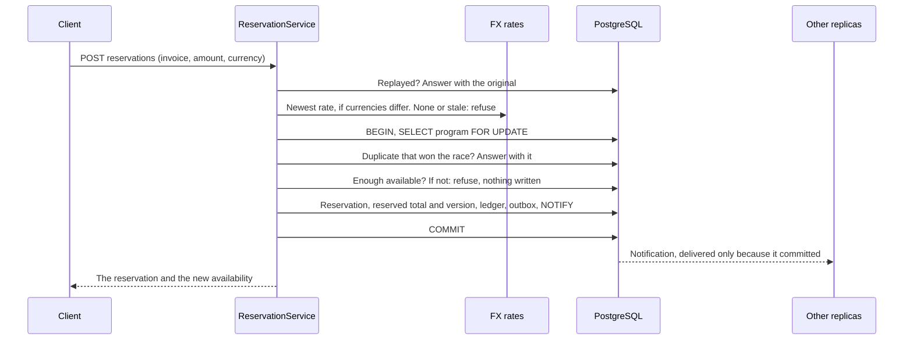

# How it works

A financing program has a credit limit. An invoice approved for early payment reserves part of it, and a repayment releases it. Clients see availability as it changes, and an external treasury system stays in step over Kafka.



## Data model



Also `capacity_outbox_events` for what treasury must hear about, `fx_rates` with `fx_rate_history`, `users` and `refresh_tokens`. Available capacity is not stored: it is `credit_limit_minor - reserved_minor`.

## A reservation



## Never oversubscribing

Every capacity mutation, from the API or Kafka, runs in a transaction that first takes the program's row lock (`SELECT ... FOR UPDATE`). "Check availability, then reserve" is therefore atomic, each program gets a gap-free version, and a single lock order rules out deadlocks. READ COMMITTED is enough: once the lock is held, each statement sees what the previous holder committed.

A `lock_timeout` turns contention into a retryable 503, and writers beyond a small per-program limit wait in memory rather than each occupying a pooled connection, so one busy program cannot starve the others.

## Money

Integer minor units in `bigint` columns and native `bigint` in code, never floats. FX conversion is one exact rational multiplication. Exponents come from an explicit currency allow-list (JPY 0, USD 2, KWD 3), and precision a currency cannot represent is rejected.

## Currencies

A cross-currency reservation converts at the newest published rate, rounds up, and locks that amount. A release frees a proportional share of what the reservation still holds, never re-converting, so FX moves cannot leak or strand capacity and partial releases sum to exactly what was reserved. A missing or stale rate fails closed (422, 503). Every published rate is kept in an append-only history for audit.

| Step | Invoice outstanding | Program outstanding | Frees |
|---|---|---|---|
| Reserve 1,000.00 EUR at 1.086352 | 1,000.00 EUR | 1,086.36 USD | |
| Repay 400.00 EUR, whatever the rate is now | 600.00 EUR | 651.82 USD | 434.54 USD |
| Repay the last 600.00 EUR | 0.00 EUR | 0.00 USD | 651.82 USD |

## Idempotency

Reservations are unique per (program, invoice) and releases per (reservation, repayment). A retry returns the original result with `isIdempotentReplay: true`; the same key with a different payload is a 409.

## The database as the last line of defence

Whatever the code does, `CHECK` constraints refuse an unknown status, a negative or excessive outstanding amount, or a released reservation still holding capacity. The ledger, releases, reconciliations with their adjustments, and FX history are append-only, enforced by triggers. A scheduled check keeps verifying that each program's reserved total, reservations and ledger agree.

## Real time

`NOTIFY` is sent inside the transaction, so subscribers hear about a change only once it commits, on any replica. The stream sends current state, then every change, with a `version` for ordering. It ends when the access token expires, so a stream cannot outlive its credential, and bursts are coalesced per program. The listening connection is asked regularly whether it still answers, so one lost silently in a failover is replaced within seconds rather than showing stale figures as live. Native `EventSource` cannot send an auth header, so clients use a fetch-based SSE client.

## The treasury feed

At-least-once, and safe under redelivery and reordering. Reservations and releases are idempotent by their own keys, so a duplicate changes nothing and a late one still counts: dropping it would understate exposure until the next snapshot. Only a newer snapshot, which already includes its effect, makes one irrelevant. Limit changes are last-writer-wins by `sequence`, and a snapshot overtaken by a newer message is ignored. All of this is checked and advanced under the row lock.

A failing message is retried in place, which keeps order but holds up the feed, so retrying always ends. Anything that can never succeed (bad schema, a database data error) goes straight to a dead-letter topic. Anything unexplained follows after about 100 seconds if the database answers, because then the problem is the message. Only a database that cannot work (unreachable, out of disk, read-only) retries indefinitely, since dead-lettering would empty the feed. Nothing is lost: the next reconciliation brings the program back in line.

The contract is in [kafka.md](kafka.md).

## Reconciliation

Treasury is authoritative, but its snapshot is a view from the past. What it can know ends at its `asOf`, and earlier if one of our events did not reach it in time: still undelivered, or delivered too shortly before `asOf`.

```
cutoff = min(asOf, now, oldest event treasury cannot have absorbed) - grace period
```

A local change newer than that line is in flight: "missing" or "different" says nothing about it, and it is left alone until a later snapshot. This is what stops a reconcile from wiping a reservation just made, resurrecting one just repaid, or oversubscribing after a relay outage.

Snapshots are validated first (control total, duplicates, no `asOf` from the future), so a truncated message cannot free capacity. They are diffed in memory, so all the lock waits for is one read of the active book and one bulk write of what drifted: when treasury re-marks every one of 20,000 positions, a writer waiting on that program gets through in about a second. The ledger has one entry per reconciliation, and every reservation it changed is recorded behind that entry, however many.

## Outbound events

A transactional outbox tells treasury about API changes, so its snapshots can include them. One replica relays at a time to preserve per-program order. Published rows stay for a day, because reconciliation needs to know when treasury heard.

## Authentication

Global JWT guard, so an endpoint is protected by default. Short-lived access tokens, rotating refresh tokens in an httpOnly `SameSite=Strict` cookie with reuse detection, argon2 passwords. Login is rate-limited per IP and per account, the API per user, and open streams per user. Probes and scrapes use a shared token and Swagger uses basic auth, so nothing is anonymous. A test walks the OpenAPI document and asserts every route rejects an anonymous call.
