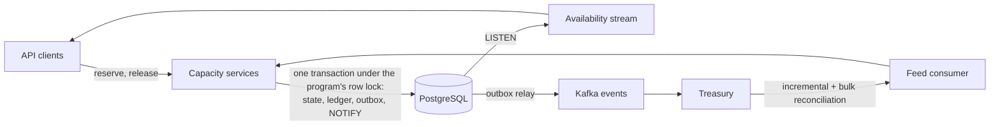

# Program Capacity Service

Tracks a financing program's credit capacity in real time: accepts reservations for invoices approved for early payment, releases capacity on repayment, exposes availability over REST and a live stream, and stays in step with an external treasury system over Kafka.

NestJS, PostgreSQL, Kafka. Code organization follows [architecture.md](architecture.md).

## Run it

Needs Docker. This starts PostgreSQL, Kafka, the API with demo data, and a simulator playing the treasury system:

```bash
docker compose up --build
```

- API: http://localhost:4000/api/v1
- Swagger: http://localhost:4000/api/docs (basic auth `docs` / `docs-local-password`)
- Demo users, password `capacity-demo-password`: `admin@capacity.local` (everything), `operator@capacity.local` (reserve, release), `viewer@capacity.local` (read only)

These credentials exist only in local configuration: in production the seed refuses to run and the app refuses to start with any of the example secrets.

To run the app itself outside Docker:

```bash
docker compose up -d postgres kafka kafka-init
```

```bash
cp .env.example .env && npm install && npm run migration:run && npm run seed
```

```bash
npm run start:dev
```

```bash
npm run treasury:simulate
```

## Try it

```bash
TOKEN=$(curl -s localhost:4000/api/v1/auth/login -H 'content-type: application/json' \
  -d '{"email":"operator@capacity.local","password":"capacity-demo-password"}' | jq -r '.accessToken')
PROGRAM=$(curl -s localhost:4000/api/v1/programs -H "authorization: Bearer $TOKEN" | jq -r '.items[0].id')

# Watch availability live in one terminal
curl -N localhost:4000/api/v1/programs/availability/stream -H "authorization: Bearer $TOKEN"

# Reserve in another: a EUR invoice against a USD program. Run it twice: it reserves once.
curl -s localhost:4000/api/v1/programs/$PROGRAM/reservations -H "authorization: Bearer $TOKEN" \
  -H 'content-type: application/json' -d '{"invoiceId":"INV-1","amount":"125000.00","currency":"EUR"}' | jq
```

## API

Every endpoint is authenticated. All amounts are decimal strings. Errors are `{ statusCode, code, message, details? }`; branch on `code`.

| Method and path (under `/api/v1`) | Role | Purpose |
|---|---|---|
| `POST /auth/login`, `/auth/refresh`, `/auth/logout` | credentials or refresh cookie | Session |
| `GET /programs`, `/programs/:id`, `/programs/:id/availability` | any | Current availability |
| `GET /programs/availability/stream?programId=` | any | Availability as Server-Sent Events |
| `POST /programs` | admin | Create a program |
| `GET /programs/:id/reservations`, `/reservations/:rid` | any | Reservations and their releases |
| `POST /programs/:id/reservations` | admin, operator | Reserve. Idempotent per invoice |
| `POST /programs/:id/reservations/:rid/releases` | admin, operator | Release. Idempotent per repayment |
| `GET /programs/:id/ledger-entries`, `/reconciliations` | any | Audit trail |
| `GET /fx-rates` | any | Published rates |
| `GET /health/live`, `/health/ready`, `/metrics` | probe token | Orchestrator probes, Prometheus |

## How it works



**Never oversubscribing.** Every capacity mutation, from the API or Kafka, runs in a transaction that first takes the program's row lock (`SELECT ... FOR UPDATE`). "Check availability, then reserve" is therefore atomic, each program gets a gap-free version, and a single lock order rules out deadlocks. READ COMMITTED is enough: once the lock is held, each statement sees what the previous holder committed. A `lock_timeout` turns contention into a retryable 503, and writers beyond a small per-program limit wait in memory rather than each occupying a pooled connection, so one busy program cannot starve the others.

**Money.** Integer minor units in `bigint` columns and native `bigint` in code, never floats. FX conversion is one exact rational multiplication. Exponents come from an explicit currency allow-list (JPY 0, USD 2, KWD 3), and precision a currency cannot represent is rejected.

**Currencies.** A cross-currency reservation converts at the newest published rate, rounds up, and locks that amount. A release frees a proportional share of what the reservation still holds, never re-converting, so FX moves cannot leak or strand capacity and partial releases sum to exactly what was reserved. A missing or stale rate fails closed (422, 503). Every published rate is kept in an append-only history for audit.

**Idempotency.** Reservations are unique per (program, invoice) and releases per (reservation, repayment). A retry returns the original result with `isIdempotentReplay: true`; the same key with a different payload is a 409.

**The database as the last line of defence.** Whatever the code does, `CHECK` constraints refuse an unknown status, a negative or excessive outstanding amount, or a released reservation still holding capacity. The ledger, releases, reconciliations with their adjustments, and FX history are append-only, enforced by triggers. A scheduled check keeps verifying that each program's reserved total, reservations and ledger agree.

**Real time.** `NOTIFY` is sent inside the transaction, so subscribers hear about a change only once it commits, on any replica. The stream sends current state, then every change, with a `version` for ordering. It ends when the access token expires, so a stream cannot outlive its credential, and bursts are coalesced per program. The listening connection is asked regularly whether it still answers, so one lost silently in a failover is replaced within seconds rather than showing stale figures as live. Native `EventSource` cannot send an auth header, so clients use a fetch-based SSE client.

**The treasury feed.** At-least-once, and safe under redelivery and reordering. Reservations and releases are idempotent by their own keys, so a duplicate changes nothing and a late one still counts: dropping it would understate exposure until the next snapshot. Only a newer snapshot, which already includes its effect, makes one irrelevant. Limit changes are last-writer-wins by `sequence`, and a snapshot overtaken by a newer message is ignored. All of this is checked and advanced under the row lock. A failing message is retried in place, which keeps order but holds up the feed, so retrying always ends. Anything that can never succeed (bad schema, a database data error) goes straight to a dead-letter topic. Anything unexplained follows after about 100 seconds if the database answers, because then the problem is the message. Only a database that cannot work (unreachable, out of disk, read-only) retries indefinitely, since dead-lettering would empty the feed. Nothing is lost: the next reconciliation brings the program back in line.

**Reconciliation.** Treasury is authoritative, but its snapshot is a view from the past. What it can know ends at its `asOf`, and earlier if one of our events did not reach it in time: still undelivered, or delivered too shortly before `asOf`. A local change newer than that line, minus a grace period for clock skew and processing time, is in flight: "missing" or "different" says nothing about it, and it is left alone until a later snapshot. This is what stops a reconcile from wiping a reservation just made, resurrecting one just repaid, or oversubscribing after a relay outage. Snapshots are validated first (control total, duplicates, no `asOf` from the future), so a truncated message cannot free capacity. They are diffed in memory, so all the lock waits for is one read of the active book and one bulk write of what drifted: when treasury re-marks every one of 20,000 positions, a writer waiting on that program gets through in about a second. The ledger has one entry per reconciliation, and every reservation it changed is recorded behind that entry, however many.

**Outbound events.** A transactional outbox tells treasury about API changes, so its snapshots can include them. One replica relays at a time to preserve per-program order. Published rows stay for a day, because reconciliation needs to know when treasury heard.

**Auth.** Global JWT guard, so an endpoint is protected by default. Short-lived access tokens, rotating refresh tokens in an httpOnly `SameSite=Strict` cookie with reuse detection, argon2 passwords. Login is rate-limited per IP and per account, the API per user, and open streams per user. Probes and scrapes use a shared token and Swagger uses basic auth, so nothing is anonymous. A test walks the OpenAPI document and asserts every route rejects an anonymous call.

## Kafka contract

| Topic | Direction | Key | Content |
|---|---|---|---|
| `treasury.capacity.v1` | in | program code | `{ eventId, type, programCode, sequence, occurredAt, payload }` with `type` one of `PROGRAM_UPSERTED`, `CAPACITY_RESERVED`, `CAPACITY_RELEASED`, `PROGRAM_RECONCILED` |
| `treasury.fx-rates.v1` | in | `BASE/QUOTE` | `{ baseCurrency, quoteCurrency, rate, asOf }`, 1 base = rate quote |
| `treasury.dead-letter.v1` | out | as received | The original message, with `x-dead-letter-reason` and `x-source-*` headers |
| `program-capacity.events.v1` | out | program code | `PROGRAM_CREATED`, `CAPACITY_RESERVED`, `CAPACITY_RELEASED`, with `programVersion` for deduplication |

The schemas are in [treasury-message-schemas.constants.ts](src/modules/treasury/treasury-message-schemas.constants.ts). A reconciliation carries `{ name, currency, creditLimit, asOf, totalOutstanding, positions[] }`, where `positions` lists only what is still outstanding, each as `{ invoiceId, invoiceCurrency, invoiceAmount, outstandingInvoiceAmount, outstandingProgramAmount }`.

## Operations

**Signals.** `GET /api/v1/metrics` for Prometheus, including event loop lag. Every request is logged with its `x-request-id`, route, status and duration, and handling a feed message under its topic, partition and offset; `logger.critical` marks what should page someone.

**Deploying.** The same image runs in any role: `KAFKA_CONSUMER_ENABLED` and `CRONS_ENABLED` turn the consumer and scheduled work on or off per replica. Once snapshots get large, run consumers apart from the API, since parsing a very large message blocks that process's event loop. `NODE_ENV=production` refuses to start without TLS to PostgreSQL and Kafka, a `Secure` cookie or a reconciliation grace period, or with an example secret. On shutdown, streams are ended and requests in flight finish before connections close.

| What you see | Where | What to do |
|---|---|---|
| Feed falling behind | `treasury_consumer_lag_messages`, readiness `degraded`, `treasury_message_retries_total` | If the database cannot work it resumes by itself once it can. Otherwise the stuck message reaches the dead-letter topic within about 100 seconds |
| Dead letters | `treasury_messages_total{outcome="dead_lettered"}`, critical log | Read `x-dead-letter-reason`. No action is needed for correctness, since the next reconciliation repairs the program. Fix the producer |
| Outbound events stuck | `capacity_outbox_oldest_unpublished_age_seconds` | Kafka is unreachable. Events wait safely, and reconciliation automatically treats what they describe as in flight |
| Refused writes on one program | `capacity_program_lock_timeouts_total`, `capacity_program_lock_wait_seconds` | Clients get a retryable 503. Sustained, it needs sub-limits (see trade-offs) |
| Books disagree | `capacity_invariant_violations` above 0, critical log listing the programs | A bug or manual change. Stop and investigate from the ledger; nothing repairs this automatically |
| Program over limit | Critical log after a reconciliation, `isOverLimit` in the API | Treasury lowered the limit. New reservations are refused until repayments bring it back |

## Tests

Three levels: unit tests cover all the logic, integration tests the main seams, end-to-end tests the main interaction scenarios.

```bash
npm run test:cov
```

```bash
npm run test:integration
```

Integration tests start their own PostgreSQL and Kafka containers, so they only need Docker. End-to-end scenarios are in [`../e2e`](../e2e).

| Guarantee | Proven by |
|---|---|
| A limit is never exceeded under parallel requests | `reservations.integration-spec`: "never oversubscribes a program under parallel reservations", "stays consistent under a mix of parallel reserves and releases" |
| One busy program does not starve the others | `reservations.integration-spec`: "keeps serving other programs while one program's writers queue up" |
| Reserving and releasing are idempotent, even in parallel | `reservations.integration-spec`: "counts parallel duplicates of one invoice exactly once", "frees capacity once when parallel requests carry the same repayment"; e2e `reservations.spec`: "retrying the same invoice reserves only once" |
| Money conversion is exact and rounds up, for any amount and rate | `money.utils.property.spec` |
| Partial releases sum to exactly what was reserved, whatever the split | `capacity-math.utils.property.spec`; `reservations.integration-spec`: "supports partial repayments that sum to exactly the reserved amount" |
| An FX move cannot leak or strand capacity | `reservations.integration-spec`: "frees exactly what was reserved even after the rate moves"; e2e `cross-currency.spec` |
| A stale or missing rate fails closed | `fx-rate-lookup.service.spec`; `reservations.integration-spec`: "refuses to convert with a stale rate, but still answers replays" |
| A duplicate feed message changes nothing | `reconciliation.integration-spec`: "applies a redelivered snapshot once", "applies incremental treasury messages idempotently"; e2e `live-updates.spec` |
| A late feed message still counts, unless a snapshot covers it | `reconciliation.integration-spec`: "still counts a reservation delivered late, rather than understating exposure", "keeps the newest limit when limit changes arrive in the wrong order", "ignores an incremental message the snapshot already covers"; e2e `live-updates.spec` |
| A poison message cannot stop the feed, and an outage does not empty it | `treasury-kafka.integration-spec`: "dead-letters a bad message and keeps consuming the partition behind it"; `treasury-feed.event-listener.spec`: "keeps retrying past the limit"; e2e `live-updates.spec` |
| Reconciliation never touches what is in flight | `reconciliation-diff.utils.property.spec`; `reconciliation.integration-spec`: "keeps a reservation made after the snapshot was taken", "does not resurrect capacity for a release made after the snapshot was taken"; e2e `live-updates.spec` |
| A truncated snapshot cannot free capacity | `reconciliation.integration-spec`: "rejects a snapshot whose positions do not add up, changing nothing" |
| A large snapshot holds writers up only briefly | `reconciliation.integration-spec`: "reconciles a large book without losing a reservation made while it runs" re-marks 20,000 positions with a writer waiting, and bounds the wait |
| Everything a reconciliation changes can be traced | `reconciliation.integration-spec`: "records every reservation a reconciliation changes, however many" |
| Live changes reach every replica | `availability-stream.integration-spec`: "fans out across replicas: a change on one instance reaches streams on another" |
| A figure on screen never moves backwards | `apply-availability-to-cache.spec` in the frontend |
| Nothing is reachable anonymously | `auth.integration-spec`: "rejects an anonymous call to every route in the API", "protects %s with basic auth" for each docs path in any letter case; e2e `security.spec` |
| A stolen refresh token kills the session | `auth.integration-spec`: "rotates the refresh token and revokes the family when a stale one is replayed" |
| The audit trail cannot be rewritten | `database-integrity.integration-spec`: audit trail |
| The database refuses invalid state by itself | `database-integrity.integration-spec`: "constraints the application is not the only guard of" |
| Migrations are complete and reversible | `database-integrity.integration-spec`: schema |
| The UI meets WCAG AA and its CSP holds | e2e `accessibility.spec`, `security.spec` |

### Load

[A k6 scenario](load/capacity.k6.js) measured on a laptop (M1 Pro) with one API replica, PostgreSQL and Kafka all sharing Docker Desktop's 8 vCPUs, with nothing tuned. To repeat it, see the top of that file.

| Scenario | Throughput | Latency, average and p95 |
|---|---|---|
| 20 writers, all on one program's row lock | 300 writes/s | 67 ms, 87 ms |
| 40 writers across 20 programs | 470 writes/s | reserve 104 ms, 123 ms; release 66 ms, 80 ms |
| Both at once, plus 300 availability reads/s | 620 requests/s | read 49 ms, 64 ms; reserve 167 ms, 206 ms; reserve on the hot program 881 ms, 1.04 s |

No request failed in any run, and each ended with nothing left reserved on any program, which is the point of the exercise. Adding replicas helps across programs, since the row lock only serializes writes to one program, until the database becomes the limit (see trade-offs). The last row shows the cost of the row lock: a hot program's writers queue while everything else competes for the same process.

## Assumptions

- The treasury contract is mine to define, since the brief leaves it open. It must provide a strictly increasing per-program `sequence`, and it hears about API changes through the events topic.
- Treasury is the system of record for limits and settled positions, and may lower a limit below what is reserved. That over-limit state is representable: availability goes negative and new reservations are refused.
- Exposure stays at the rate locked at reservation until treasury re-marks it in a reconciliation.
- One reconciliation is one Kafka message (topic limit raised to 16 MB). An invoice reserves once per program and is not reusable after repayment.
- Any authenticated user may see any program. Per-client program scoping needs a tenancy model the brief does not describe.

## Trade-offs

- **Row lock, not optimistic concurrency.** Throughput per program is serialized but transactions take milliseconds, and capacity checks must not fail spuriously. A very hot program would need sharded sub-limits.
- **LISTEN/NOTIFY, not Redis or Kafka fan-out.** No extra infrastructure, and transactional by construction. It needs a direct connection, not a transaction-mode pooler, and PostgreSQL serializes the commits of notifying transactions on a global lock, so at very high write rates across programs this is what to replace first. The outbox already carries the same events.
- **The grace period must exceed treasury's processing lag.** If treasury takes longer than that to absorb an event, a snapshot can briefly close a reservation; the next one reopens it. Trading this for a logical watermark would need treasury's cooperation.
- **While a message retries, the feed waits.** kafkajs does not fetch again until a whole batch is done, so every program and FX rates stall with it, for about 100 seconds at worst. Chosen over reordering a program's messages. Readiness reports `degraded` meanwhile, and it pages via `logger.critical`.
- **Reordering can overstate exposure until the next snapshot.** A release delivered before its reservation finds nothing to release, and the reservation then counts in full. That direction is the safe one: capacity looks smaller, never larger. `sequence` itself is trusted: a corrupt, absurdly high value would mute that program's snapshots until corrected by hand, and each ignored snapshot logs a warning.
- **Access tokens are stateless.** A revoked user keeps access until the token expires, 15 minutes at most.
- **The per-account login limit can be used to lock someone out** for as long as an attacker keeps trying. Accepted: it costs them a request a minute per victim, and guessing passwords is the worse outcome.
- **Rate limits count per replica**, in memory. Sharing them needs Redis, which nothing else here needs yet.
- **kafkajs** is the de facto Node client but barely maintained, and logs a harmless `TimeoutNegativeWarning` once at startup. It sits behind one client class, so swapping it is contained.

## Not done

Distributed tracing (the request id correlates a request's logs); an operator UI for replaying dead letters; a production identity provider instead of the built-in user table; multi-message reconciliation for books beyond 16 MB. `npm audit --omit=dev` is clean and enforced in CI; what remains in `npm audit` is moderate advisories in test and build tooling, which does not ship.
